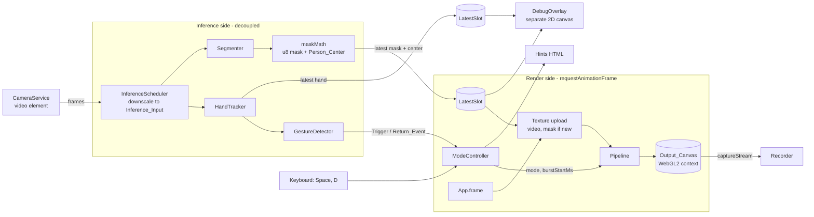
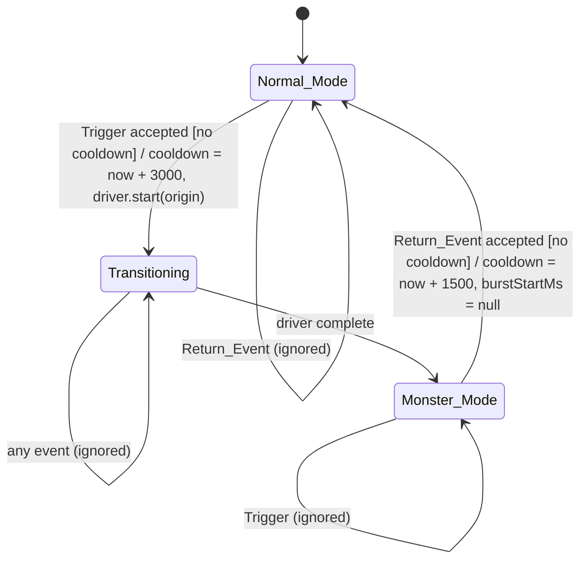

# Design Document

## Overview

Haunted Photobooth is a client-side Vite + TypeScript (vanilla) app. It shows a mirrored webcam feed, and on a held fist (or Spacebar) it switches to a stylized Monster Mode in a flat anime cel look: a deep purple duotone person cutout with dark ink outlines and a ghost mint glow, over an indigo and violet halftone background on midnight paper, with a single wispy ghost-mint ghost-fire rising behind the person and about 20 cute flat 3D ghosts floating around. There is no text in the scene and the UI is icon-only. A held open palm (or Spacebar) returns to Normal Mode. A 5-second WebM recorder captures the final canvas.

The design rests on five decisions:

1. **One canvas, one WebGL2 context, shared with Three.js.** The App creates the Output_Canvas and its WebGL2 context. The same context is passed to `THREE.WebGLRenderer`. Three renders the ghost particles only into its own render target; the raw pipeline composites that texture. See "Three.js and Raw WebGL2 Coexistence".
2. **Pass-based pipeline.** Each effect is a class in its own file under `src/passes/` with GLSL in `src/shaders/*.glsl`, imported through Vite `?raw`.
3. **Inference is decoupled from rendering.** A separate scheduler feeds reduced-resolution frames to MediaPipe and publishes results into a latest-value slot. The render loop only reads that slot and never awaits.
4. **Everything the user sees in a recording is drawn into the Output_Canvas.** That includes the person, background, flames, and ghosts. Hints, the Debug_Overlay, the Record_Button, and the permission screens are HTML or separate canvases layered above the Output_Canvas, so they never appear in recordings.
5. **Pure logic is separated from GL and DOM.** Gesture detection, the Mode_Controller, the stepped clock, wedge generation, particle simulation, and centroid math are pure TypeScript modules with injected clocks and seeded RNGs, so they can be property-tested.

### Burst Timing

The particle burst starts at the **Burst_Start**: the moment the Wedges begin separating (the end of the Crack_Effect), so particles fly out through the cracks while the shatter is still playing. In Phases 1 to 4, where the `ImmediateDriver` has no crack phase, Burst_Start is the moment Monster_Mode is entered. The particle passes are enabled from Burst_Start until the return to Normal_Mode.

### Research Findings

- **MediaPipe Tasks Vision (JS).** `HandLandmarker.detectForVideo` and `ImageSegmenter.segmentForVideo` are synchronous calls that return after inference, so they block the main thread for their duration. "Never await inference" therefore means the render loop never waits on the scheduler, and the scheduler time-slices the two models so that each main-thread block stays short. Both tasks create their own internal WebGL context (they are never given our canvas), so they cannot corrupt our GL state. The selfie segmenter returns a confidence mask (`outputConfidenceMasks: true`); with the callback form of `segmentForVideo` the mask is only valid inside the callback, so the data is copied there. See [MediaPipe Image Segmenter web guide](https://ai.google.dev/edge/mediapipe/solutions/vision/image_segmenter/web_js) and [Hand Landmarker web guide](https://ai.google.dev/edge/mediapipe/solutions/vision/hand_landmarker/web_js).
- **Three.js with an external context.** `new THREE.WebGLRenderer({ canvas, context })` adopts an existing context. Three caches GL state internally (bound framebuffer, program, textures, blend, depth), so any raw GL call between Three calls makes the cache stale. `renderer.resetState()` clears Three's state and binding caches so it re-issues every call it needs. See [WebGLRenderer docs](https://threejs.org/docs/#api/en/renderers/WebGLRenderer).
- **Render targets and color.** Output color space conversion and tone mapping apply only when Three renders to the screen, not to a render target. With `THREE.ColorManagement.enabled = false` palette hex values are used as written, so the whole pipeline stays in display-referred sRGB values. See [Color management](https://threejs.org/docs/#manual/en/introduction/Color-management).
- **Recording.** `HTMLCanvasElement.captureStream(0)` plus `track.requestFrame()` after each rendered frame gives deterministic frame delivery. `MediaRecorder.isTypeSupported` selects a WebM codec; Safari lacks WebM, which maps to the "unsupported" requirement. See [captureStream](https://developer.mozilla.org/en-US/docs/Web/API/HTMLCanvasElement/captureStream) and [MediaRecorder](https://developer.mozilla.org/en-US/docs/Web/API/MediaRecorder).
- **Existing scaffold.** `src/main.ts`, `src/counter.ts`, `src/style.css`, `src/assets/*` and `index.html` are the Vite template. `package.json` has only `typescript` and `vite`. `tsconfig.json` uses `erasableSyntaxOnly` (no enums or parameter properties), `noUnusedLocals`, and `vite/client` types, which already declare `*?raw` imports for `.glsl?raw`. Phase 1 replaces the template content.

## Architecture

### Module Layout

```
index.html                    # #stage (canvas + overlays), #hint, #screens, #record
public/
  mediapipe/wasm/             # copied from node_modules by scripts/copy-mediapipe.mjs (predev, prebuild)
  models/                     # hand_landmarker.task, selfie_segmenter.tflite (versioned, local)
scripts/copy-mediapipe.mjs
src/
  main.ts                     # bootstrap only
  app/
    App.ts                    # wires services, owns the frame loop
    config.ts                 # constants: palette, timings, sizes, PARTICLE_COUNT (20), clear zone, PARTICLE_COUNT (20), clear zone
    palette.ts                # midnight, indigo, violet, lavender, ghost mint, mint shadow
    SteppedClock.ts           # 18 fps step index/time (pure)
    LatestSlot.ts             # latest-result handoff (pure)
    rng.ts                    # seeded PRNG (mulberry32)
  camera/CameraService.ts     # getUserMedia, error classification
  inference/
    InferenceScheduler.ts     # decoupled loop, time-slicing
    HandTracker.ts
    Segmenter.ts
    maskMath.ts               # float->u8 conversion, Person_Center (pure)
  gesture/
    classify.ts               # landmarks -> Fist | Open_Palm | Other (pure)
    GestureDetector.ts        # hold timers, events (pure, injected time)
  mode/
    ModeController.ts         # state machine (pure, injected time)
    TransitionDriver.ts       # interface + ImmediateDriver (Phase 1) + ShatterDriver (Phase 5)
  gl/
    GlContext.ts              # canvas + WebGL2 creation, loss handling
    GlState.ts                # baseline state + dev-time state guard
    Quad.ts                   # shared fullscreen triangle VAO
    Program.ts                # compile/link helper, uniform cache
    Targets.ts                # FBO/texture helpers
    Textures.ts               # video + mask textures
  passes/
    Pass.ts                   # RenderPass interface, FrameState
    Pipeline.ts               # ordered pass lists per mode
    FeedPass.ts               # mirrored camera to target (Normal_Mode, Phase 1)
    MaskBlurPass.ts           # Phase 3
    PersonPass.ts             # Phase 2 (duotone, ink outline, mint glow) (duotone, ink outline, mint glow)
    BackgroundPass.ts         # Phase 3 (halftone only)
    FlamesPass.ts             # Phase 3 (single ghost-fire)
    ParticlePass.ts           # Phase 4, the only file family that imports three
    particles/                # kinds.ts (ghost only), geometry.ts (ghost shape), simulation.ts (pure), toon.ts
    ParticleCompositePass.ts  # Phase 4
    ShatterPass.ts            # Phase 5
    shatter/                  # wedges.ts (pure), timeline.ts (pure)
    PresentPass.ts            # target -> default framebuffer
  shaders/
    fullscreen.vert.glsl  feed.frag.glsl  kuwahara_gradient.frag.glsl  person.frag.glsl
    maskblur.frag.glsl  halftone.frag.glsl  flames.frag.glsl
    composite.frag.glsl  shatter.frag.glsl  present.frag.glsl
  ui/
    Hints.ts (icons)  PermissionScreen.ts  WebGLMissingScreen.ts  DebugOverlay.ts  RecordButton.ts (record-dot icon + countdown ring)
  recorder/Recorder.ts  recorder/format.ts
  style.css
```

Three.js is imported only from `src/passes/ParticlePass.ts` and `src/passes/particles/*`. The pure simulation file imports no Three types so it stays testable without a GL context.

### System Diagram



### Sizing and Aspect Ratio

The Output_Canvas internal resolution is the camera resolution scaled down so its width is at most 1280 (aspect preserved), fixed once the camera reports its size. CSS scales the canvas to the viewport with contain-fit centered on a #0A0A0A background. A resize event recomputes only the CSS rect (`fitRect(viewport, canvasSize)`), so the aspect ratio is always the camera's and recordings have a stable size. All internal render targets use this size, except the mask blur target (1/4 scale) and the Kuwahara stage (optionally 1/2 scale).

### Three.js and Raw WebGL2 Coexistence

**Decision: one shared WebGL2 context. Three.js renders the particles into a Three-owned `WebGLRenderTarget`, and the raw pipeline samples that render target's texture and composites it.**

Alternatives considered:

| Option | Pros | Cons |
| --- | --- | --- |
| A. Two canvases/contexts (Three on its own canvas, stacked) | No state sharing at all | Particles are not in the Output_Canvas, so recording needs a manual composite via `drawImage` of a WebGL canvas (GPU to CPU readback or extra copies). Layering with the shatter is impossible. Two contexts cost memory on integrated GPUs. Rejected. |
| B. Two contexts, texture transfer through 2D canvas | Isolated state | Same readback cost every frame. Rejected. |
| C. Shared context, Three draws straight to the default framebuffer last | No texture handoff | The shatter pass needs the entire Monster frame as a texture. Rejected. |
| **D. Shared context, Three to render target, raw pass composites** | One context, no readback, particles and shatter compose naturally, recorder sees one canvas | Requires disciplined GL state hand-off and reading Three's internal texture handle (mitigated below). **Chosen.** |

**Ownership.** `GlContext` creates the canvas and calls `canvas.getContext('webgl2', { alpha: false, antialias: false, depth: false, stencil: false, premultipliedAlpha: false, preserveDrawingBuffer: false, powerPreference: 'high-performance' })`. If this returns `null`, the WebGL2-missing screen is shown and nothing else starts. The default framebuffer therefore has no depth buffer and is opaque; it is only ever written by `PresentPass`/`ShatterPass`. The context is then handed to Three:

```ts
THREE.ColorManagement.enabled = false;               // before any Three object is created
const renderer = new THREE.WebGLRenderer({ canvas, context: gl });
renderer.autoClear = false;
renderer.outputColorSpace = THREE.LinearSRGBColorSpace; // no conversion
renderer.toneMapping = THREE.NoToneMapping;
renderer.setClearColor(0x000000, 0);
// Never call renderer.setSize / setPixelRatio: the canvas size is owned by GlContext.
```

Three is version-pinned exactly in `package.json`.

**Color, tone mapping, alpha.**

- The whole pipeline works in display-referred sRGB values: the video is uploaded as plain `RGBA8` (no `SRGB8_ALPHA8`), palette constants are used as written, no shader applies gamma. With `ColorManagement.enabled = false` Three does the same for particle colors.
- Tone mapping is `NoToneMapping`; output color space is a no-op. (Three ignores both when rendering to a render target, so the setting also guards against someone later rendering to the screen.)
- The particle render target is `RGBA8`, `samples: 4` (resolved by Three at the end of `render`), `depthBuffer: true`, `colorSpace: NoColorSpace`, linear min/mag filtering, no mipmaps. It is cleared to `(0,0,0,0)` each frame. Particle materials are opaque; with Three's normal blending the antialiased edge pixels are written premultiplied (`rgb*a`, `a`). The target is therefore treated as **premultiplied alpha**, and `ParticleCompositePass` blends with `blendFunc(ONE, ONE_MINUS_SRC_ALPHA)`.
- All raw intermediate targets are `RGBA8`. `PersonPass` and `FlamesPass` output premultiplied color too. `UNPACK_PREMULTIPLY_ALPHA_WEBGL` stays `false` for every upload. The final canvas is opaque (`alpha: false`), so no browser compositing step reinterprets alpha.

**Getting the Three texture to the raw pass.** After `renderer.render`, the `WebGLTexture` handle is obtained once per frame with `renderer.properties.get(target.texture).__webglTexture`. This is an internal property, so: (1) Three is pinned to an exact version; (2) `ParticlePass.init` runs a self-test (render one frame, assert the handle is a `WebGLTexture` and `gl.isTexture` is true) and throws a clear error if not, which disables the Particle_Pass while the rest of Monster_Mode remains functional; (3) a unit/smoke test fails on upgrade if the property disappears. `ParticleCompositePass` binds that handle to texture unit 0 as `TEXTURE_2D` and draws.

**Per-frame order of calls (Monster_Mode / Transitioning).** Three runs first in the frame, as one contiguous block, so the state boundary is crossed exactly twice per frame:

```mermaid
sequenceDiagram
  participant App as App.frame
  participant Raw as Raw passes (gl)
  participant Three as ParticlePass (Three)
  App->>App: stepped clock update, read LatestSlots
  App->>Raw: GlState.applyBaseline(gl)
  App->>Raw: upload video texture, upload mask texture if version changed
  Note over App,Three: Boundary 1: raw to Three
  App->>Three: renderer.resetState()
  App->>Three: simulate on step change, update instance matrices
  App->>Three: renderer.setRenderTarget(rt); clear; render(scene,camera); setRenderTarget(null)
  Note over App,Three: Boundary 2: Three to raw
  App->>Raw: GlState.applyBaseline(gl) (+ dev-mode guard check)
  App->>Raw: MaskBlur (if mask dirty), Background, Flames, Person
  App->>Raw: ParticleComposite (samples rt texture)
  App->>Raw: Shatter (Transitioning) or Present (Monster) to default framebuffer
  App->>App: recorder.onFrame() (requestFrame), debug overlay update
```

The Three block is skipped entirely on frames where `ParticlePass.enabled` is false (before Burst_Start and in Normal_Mode).

**State reset, Boundary 1 (raw to Three).** Before Three draws, call `renderer.resetState()`. That invalidates Three's caches, so it re-binds its framebuffer, program, VAO, textures, and re-applies blend/depth/cull/viewport/scissor from scratch on the first draw. We do not try to restore raw state for Three; we make Three forget what it knows. Additionally, `GlState.applyBaseline` runs just before so that pixel-store state raw code changed (flip-Y, premultiply) is at the defaults Three expects (`UNPACK_FLIP_Y_WEBGL=false`, `UNPACK_PREMULTIPLY_ALPHA_WEBGL=false`, `UNPACK_ALIGNMENT=4`).

**State reset, Boundary 2 (Three to raw).** Three leaves arbitrary state, so raw code never assumes anything. `GlState.applyBaseline(gl)` explicitly sets all of the following, and each raw pass calls `GlState.begin(gl, target, viewport, blendMode)` which re-applies the relevant subset before drawing:

| State | Baseline value |
| --- | --- |
| Framebuffer binding (DRAW and READ) | The pass's own target (`bindFramebuffer(FRAMEBUFFER, fbo)`) |
| Viewport | `(0, 0, target.w, target.h)` |
| `SCISSOR_TEST`, `DEPTH_TEST`, `STENCIL_TEST`, `CULL_FACE`, `DITHER`, `POLYGON_OFFSET_FILL`, `SAMPLE_ALPHA_TO_COVERAGE` | disabled |
| `depthMask`, `colorMask` | `true`, `(true,true,true,true)` |
| `frontFace` | `CCW` |
| Blend | `BLEND` per pass: off, or `blendFunc(ONE, ONE_MINUS_SRC_ALPHA)` for premultiplied composites; `blendEquation(FUNC_ADD)` |
| Clear color | `(0,0,0,0)` |
| Current program | `useProgram(pass.program)` (set by the pass, never assumed) |
| VAO | `bindVertexArray(quad.vao)`; raw code never uses the default VAO and never sets vertex attributes outside its own VAOs |
| Active texture unit | `activeTexture(TEXTURE0)`; each pass binds every sampler texture to an explicit unit before each draw (units 0-3 reserved for raw passes) |
| Pixel store | `UNPACK_FLIP_Y_WEBGL=false`, `UNPACK_PREMULTIPLY_ALPHA_WEBGL=false`, `UNPACK_ALIGNMENT=4`, `UNPACK_COLORSPACE_CONVERSION_WEBGL=NONE` |
| Read buffer / draw buffers | `COLOR_ATTACHMENT0` |

Texture uploads set the pixel-store values they need immediately before `texImage2D`/`texSubImage2D` and restore the defaults right after, so no upload leaks state to the next call, either raw or Three.

**Dev-time state guard.** In `import.meta.env.DEV`, `GlState.assertBaseline(gl)` runs after Boundary 2 and logs a warning listing any differences it finds between queried GL state (`gl.getParameter`, `gl.isEnabled`) and the baseline, which catches accidental reliance on stale state.

**Frame order summary.** Particle render (Three) first, then raw passes, then the final pass to the default framebuffer, so the default framebuffer is written by raw code only. Three never touches `framebuffer = null`.

**Disposal.** On `pagehide`, `ParticlePass.dispose()` disposes geometries, materials, the toon gradient texture, the render target, then `renderer.dispose()`; raw passes delete their programs, textures, and FBOs; finally `WEBGL_lose_context.loseContext()` is called.

### Render Order and Pass Interface

```ts
export interface FrameState {
  gl: WebGL2RenderingContext;
  nowMs: number;
  step: number;            // integer 18 fps step index
  stepTimeSec: number;     // step / 18, constant within a step
  mode: 'normal' | 'transitioning' | 'monster';
  burstStartMs: number | null;  // set at Burst_Start, cleared on return to Normal_Mode
  size: { w: number; h: number };
  textures: { video: WebGLTexture; mask: WebGLTexture; maskBlur: WebGLTexture };
  maskVersion: number;     // increments when a new mask is uploaded
  personCenter: { x: number; y: number };  // normalized, mirrored, y down
  hasSegmenter: boolean;
  transition: { progress: TransitionSnapshot; origin: { x: number; y: number } } | null;
  targets: { monster: Target; normal: Target };
}

export interface RenderPass {
  readonly name: string;
  init(ctx: GlContext): void;
  enabled(frame: FrameState): boolean;
  render(frame: FrameState): void;     // writes only to the target it was told to
  resize(w: number, h: number): void;
  dispose(): void;
}
```

`Pipeline` holds three fixed ordered lists:

- Normal_Mode: `FeedPass → (default framebuffer)`.
- Monster_Mode: `ParticlePass(Three) → MaskBlurPass → BackgroundPass → FlamesPass → PersonPass → ParticleCompositePass → PresentPass`. Everything before `PresentPass` writes into `targets.monster`.
- Transitioning: the Monster list without `PresentPass`, plus `FeedPass → targets.normal`, then `ShatterPass` (reads both, writes the default framebuffer).

**Enabled predicates for the burst passes.** `ParticlePass` and `ParticleCompositePass` are enabled when `burstStartMs !== null`, that is from Burst_Start (during the separation phase of Transitioning, and throughout Monster_Mode) until the return to Normal_Mode. Before Burst_Start, during the Crack_Effect, they are disabled, so the monster frame under the cracks has no ghosts yet.

Back-to-front inside `targets.monster`: halftone (opaque base on midnight paper) → flames (single ghost-fire, premultiplied over) → person (premultiplied over) → ghost particles. This satisfies "Flames behind Person, in front of Halftone" and "Particles in front of Person".

Before their phase exists, passes are simply absent from the lists, so each phase is runnable. In Phase 1 the Monster list is `FeedPass → PresentPass` (the Hint and mode state still change).

### Inference Loop (Decoupled)

`InferenceScheduler` runs on its own timer chain (`setTimeout` driven, using `video.requestVideoFrameCallback` when available to avoid re-processing the same frame). The render loop does not call into it, wait on it, or await its promises.

- **Inference_Input.** A small 2D canvas: the video is drawn unmirrored into a 256x256 canvas for the segmenter (stretched; the selfie model expects 256x256) and a 320x180-ish canvas (camera aspect, width 320) for the hand tracker. Both are smaller than the camera frame.
- **Time-slicing.** Because MediaPipe calls are synchronous, each scheduler tick runs exactly one model: hand tracking on every tick, segmentation on every second tick (about 20 Hz hand, about 10 to 15 Hz mask, adapting to measured cost via an EMA; if both together exceed the budget, the mask rate drops to a floor of 10 Hz to satisfy the Person_Center rate). The per-tick main-thread cost is shown in the Debug_Overlay. If profiling shows jank, both models can move to a Worker later without changing the `LatestSlot` contract.
- **Hand results.** `HandTracker` returns normalized landmarks. `GestureDetector` consumes them with the sample timestamp, and `LatestSlot<HandResult>` stores the newest for the Debug_Overlay.
- **Mask results.** In the `segmentForVideo` callback the float confidence mask is converted to a `Uint8Array(256*256)` (`maskMath.toU8`, clamped), `Person_Center` is computed from it, and `LatestSlot<MaskResult>` stores `{ version, data, center }`. Nothing is uploaded to the GPU inside the callback; the render loop does that.
- **LatestSlot.** `publish(v)` overwrites and increments `version`; `read()` returns the latest value and version synchronously and never blocks. The render loop compares `version` with the last uploaded one.
- **Failure.** If a model fails to load, its scheduler branch is skipped and flags (`hasHands`, `hasSegmenter`) are cleared; Spacebar is enabled as the event source for a hand failure, and the pipeline switches to the full-frame variant for a segmenter failure.

### Mask Texture Upload

The mask is `R8` (`gl.R8`, `RED`, `UNSIGNED_BYTE`), 256x256, `LINEAR` filtering, `CLAMP_TO_EDGE`, allocated once with `texStorage2D`. When `slot.version !== uploadedVersion`, the frame loop does `texSubImage2D` with `UNPACK_ALIGNMENT=1` (restored to 4 after). `R8` was chosen over `R32F` because linear filtering of float textures needs `OES_texture_float_linear`, which integrated GPUs do not always expose. Shaders treat the mask as `smoothstep(0.45, 0.55, texture(uMask, uv).r)` to produce a hard cel edge from the blocky 256x256 source. Mask UVs are x-mirrored in the shader, because inference runs on the unmirrored frame.

### Person_Center

`maskMath.personCenter(mask: Uint8Array, w, h)` returns the centroid of pixels with value ≥ 128 as normalized `(x, y)` with y down. The x coordinate is mirrored (`1 - cx`) so it matches the Mirrored_Feed. If fewer than 16 pixels qualify, or the segmenter failed to load, it returns `(0.5, 0.5)`. The centroid is computed in the segmentation callback, so it updates at the segmentation rate (at least 10 Hz). The visual consumers (ghost spawn and clear zone, Flames height weighting) smooth it with a per-step lerp of 0.25 to avoid jumpy ghosts and flames.

### Gesture Detector

`classify(landmarks)` (pure) returns `'fist' | 'open_palm' | 'other'` using landmark indices: wrist 0; finger tips 8, 12, 16, 20; PIPs 6, 10, 14, 18; thumb IP 3, tip 4, pinky MCP 17.

- Fist: for all four fingers, `dist(tip, wrist) < dist(pip, wrist)`.
- Open_Palm: for all four fingers, `dist(tip, wrist) > dist(pip, wrist)`, and thumb extended: `dist(thumbTip, pinkyMcp) > dist(thumbIp, pinkyMcp)`.
- Otherwise Other. The conditions are mutually exclusive by construction.

`GestureDetector.update(sample | null, nowMs, mode)` returns zero or one event:

- `sample = null` (hand lost) or a class different from the current one resets the hold timer (`holdStart = nowMs`).
- Fist reaching 250 ms returns `{ type: 'trigger', fistPosition }` where `fistPosition = { x: 1 - palm.x, y: palm.y }` and `palm` is landmark 9 (middle-finger MCP, used as palm-center). Open_Palm reaching 500 ms while `mode === 'monster'` returns `{ type: 'return' }`.
- Each event is **latched**: after it fires, the same continuous hold does not fire again until the hold resets. Events dropped by the Mode_Controller's cooldown are not retried; the user relaxes and repeats the gesture.

The Spacebar handler (`keydown`, `preventDefault`) produces `trigger` with `{0.5, 0.5}` in Normal_Mode and `return` in Monster_Mode, and is always active; the hand tracker is simply optional.

### Mode_Controller State Machine



`ModeController.dispatch(event, nowMs)` is pure with respect to time (the clock is the argument). Rules, in order:

1. If `nowMs < cooldownUntil`, ignore every event (Trigger and Return_Event, from gesture or Spacebar). The cooldown is exactly as written in the requirements: it blocks the Open_Palm hold too.
2. State Normal + Trigger: state ← Transitioning, `cooldownUntil ← nowMs + 3000`, `driver.start(origin, { onBurstStart, onComplete })`.
3. State Monster + Return: state ← Normal, `cooldownUntil ← nowMs + 1500`, `burstStartMs ← null`, and burst observers are notified so the particles hide and reset.
4. Everything else is ignored, including Return in Transitioning.
5. `onBurstStart` (called by the driver) sets `burstStartMs` and notifies burst observers; `ParticlePass` resets and shows its particles.
6. `onComplete` (called by the driver) moves Transitioning to Monster.

`TransitionDriver` is an interface. In Phases 1 to 4, `ImmediateDriver.start` calls `onBurstStart` and then `onComplete` synchronously, so the controller passes through Transitioning and lands in Monster_Mode inside the same dispatch, with the burst starting at the same moment (observers still receive the state changes in order, so Hints hide then show). In Phase 5, `ShatterDriver` replaces it: it calls `onBurstStart` once when the `ShatterPass` timeline enters the separation phase (the end of the Crack_Effect), and `onComplete` when the timeline reaches its end. Because the Trigger cooldown (3000 ms) is longer than the shatter (400 + 1200 = 1600 ms), the Monster_Mode transition always finishes inside the cooldown.

### Stepped Timing (18 fps)

`SteppedClock.update(nowMs)` returns `{ step: floor(nowMs * 18 / 1000), stepTimeSec: step / 18, changed }`. The render loop runs at display rate (target 30 fps); stylized animation reads `stepTimeSec` and `step`, never `nowMs`. Consequences:

- Shaders get `uStepTime` and `uStep`; the flames and halftone shimmer are constant within a step.
- Particle simulation advances only when `changed`, with `dt = 1/18` per step, and at most 3 catch-up steps after a hitch.
- The shatter timeline is evaluated at the quantized time `stepTimeSec`, so its motion is also 18 fps.

### Shader Designs

All fragment shaders draw a single full-screen triangle (`fullscreen.vert.glsl`, `gl_VertexID` based, no vertex buffer). All files are `#version 300 es`, `precision highp float`, imported as `import frag from '../shaders/person.frag.glsl?raw'`.

**Kuwahara + Gradient map (`kuwahara_gradient.frag.glsl`).** Four-quadrant Kuwahara with a reduced radius of 2 on the video texture (sampled mirrored), so the face and its features stay clear. For each quadrant it accumulates mean and variance over its 3x3 samples (36 taps total) and picks the mean of the lowest-variance quadrant. Cost control: the radius is a uniform. Then the purple duotone gradient map: `l = dot(rgb, vec3(0.299, 0.587, 0.114))`, quantized to 4 hard bands (`floor(l*4)/3`), mapped through the stops midnight `#0D0820` (shadows), violet `#5B3FC4` (midtones), and lavender `#B8A8FF` (highlights). Kuwahara strictly precedes the gradient map. The posterized luminance band is also written to the alpha-free channel used by the ink edge detector in the Person shader.

**Person (`person.frag.glsl`).** Reads the Kuwahara/gradient intermediate, the mask, and the blurred mask. `m = smoothstep(0.45, 0.55, mask)`. **Ink outline:** a Sobel filter on the posterized luminance (1 px at internal resolution, thickness about 2 px); where the edge magnitude passes a threshold the color is replaced with hard midnight `#0D0820` (a `step`, anime line art). **Mint glow:** sample the mask at 8 directions at two radii (4 and 7 px at internal resolution); if the pixel is inside (`m > 0.5`) and any sample is outside, output hard ghost mint `#8CFFC1` (a `step`, no gradient) as the glow outline; outside the mask, a soft outer glow `(1 - m) * smoothstep(0.05, 0.5, blurredMask)` in ghost mint at up to 0.6 alpha. Output is premultiplied. When `uHasSegmenter` is false, `m = 1`, the ink outline still applies, and the mint glow is skipped.

**Halftone (`halftone.frag.glsl`).** A 45-degree rotated grid with 10 px cells. For each cell, luminance is the average of four taps around the cell center (mirrored). Dot radius is `0.5 * cell * sqrt(l)`, so it is monotonic in luminance. Dot color is deep indigo `#1E1450` for darker cells and violet `#5B3FC4` for brighter cells; the paper color is midnight `#0D0820`. Edges use a 1 px smoothstep.

**Mask blur (`maskblur.frag.glsl`).** Two separable passes of a 9-tap Gaussian at 1/4 resolution produce `maskBlur`. They re-run only when `maskVersion` changed (dirty flag), which still satisfies "within one rendered frame".

**Flames (`flames.frag.glsl`).** One draw, one soft wispy ghost-fire rising behind the person. For each fragment, the shader accumulates mask coverage from below: it takes 6 taps of `uMaskBlur` along the downward direction (up to a reach of about 0.45 of the frame height), so the fire extends upward from the silhouette. The reach is weighted by a gaussian of the x distance to `personCenter.x`, so the flame is tallest above the head. Noise supplies the wisps:

```
n   = valueNoise(uv * scale * vec2(1.0, 0.5) + vec2(0.0, -uStepTime * speed))
sway = (n - 0.5) * wobble * h + curl * h * h        // h = height above the silhouette; curl bends the tongue tips
f   = coverage(uv + vec2(sway, 0.0)) * (1.0 - h * (0.6 + 0.4 * n))   // narrows toward the tips
a   = smoothstep(edge0, edge1, f)                                   // soft glow edge, not a hard step
color = mix(mintShadow #2E8C6A, ghostMint #8CFFC1, smoothstep(0.35, 0.85, 1.0 - a))   // shadow inside, mint at the edges
out = vec4(color * a * 0.8, a * 0.8)                                // slight transparency, premultiplied
```

Because the mask blur is already smooth, no distance field is needed. The Person pass is drawn on top, so the flame interior behind the person is hidden. When `hasSegmenter` is false the pass is disabled.

**Composite (`composite.frag.glsl`).** Samples a texture and outputs it unchanged; the pass applies premultiplied blending (`ONE, ONE_MINUS_SRC_ALPHA`). Used by `ParticleCompositePass`.

**Present (`present.frag.glsl`).** Copies `targets.monster` to the default framebuffer.

### Shatter Design

`shatter/wedges.ts` (pure): `generateWedges(seed): { widthsDeg: number[13]; boundariesRad: number[14]; dirRad: number[13]; speed: number[13]; spin: number[13]; z: number[13] }`.

- Draw 13 weights `u_i ∈ [0.55, 1.45]` from the seeded PRNG, scale to `w_i = 360 * u_i / Σu`. Repeat nudging while any cyclically adjacent pair (including `w_12` and `w_0`) has `|w_i - w_j| < 1.0°` (adding ±1.5° to one and rebalancing the sum). Reject sets with a width below 8°. The final widths sum to 360° within 1e-9.
- Boundaries are the cumulative sum starting at a random phase offset. Wedge `i` spans `[b_i, b_{i+1}]`; its bisector gives `dirRad`; `speed` and `spin` are drawn per wedge.

`shatter/timeline.ts` (pure): `timeline(tMs)` returns `{ phase: 'crack' | 'separate' | 'done', crack: 0..1, separate: 0..1 }`. Crack phase is `[0, 400)`, separation is `[400, 1600]` (1200 ms), and `done` after. `tMs` is the stepped time. `ShatterDriver` calls `onBurstStart` exactly once when the phase first becomes `separate`, and `onComplete` exactly once when the phase becomes `done`.

`shatter.frag.glsl`: uniforms are `uOrigin` (clamped to [0,1]²), 14 boundary angles, per-wedge direction/speed/spin, `uCrack`, `uSeparate`, textures `uNormal` and `uMonster`. For each fragment, loop over the 13 wedges in z order: apply the inverse of the wedge transform (translate by `-dir * speed * easedSeparate * diag`, rotate by `-spin * separate` about the origin), test whether the inverted position's angle lies inside the wedge's angular range, and if so sample `uNormal` at the inverted position (the shattering normal frame). Fragments not covered by any wedge show `uMonster`, which from Burst_Start already contains the ghost particles, so they appear to fly out through the gaps. Cracks: for each boundary ray, distance of the fragment to the ray, jittered by noise along the ray; crack length grows with `uCrack`, glow `exp(-d * k)` in ghost mint `#8CFFC1` with a hot center in lavender `#B8A8FF`. During separation, wedge edges keep a thin mint glow that fades with `uSeparate`. All angles use aspect-corrected coordinates. At `separate = 1` every wedge is fully off-screen (offset ≥ 1.2 × viewport diagonal), so the output equals `uMonster` and no wedge artifacts remain. `ShatterPass.enabled` is true only in Transitioning, so returning to Normal_Mode draws no wedges.

`clampOrigin(p)` clamps both coordinates to [0,1] before use.

### Particle Design

All particle code except the Three scene wrapper is pure.

**Kind.** There is a single Particle_Kind, `ghost`. The geometry is procedural (`particles/geometry.ts`): a `THREE.Shape` with a semicircular rounded head, straight sides, and a wavy bottom edge of 3 scallops, built as a `ShapeGeometry` (flat, under about 60 triangles) with a very shallow extrusion (0.04 units, no bevel) so the cel material still has a normal to shade. Two dark oval eyes are a second small `ShapeGeometry` (ellipses) placed just in front of the body. No assets are loaded.

**Instancing.** Three `InstancedMesh` objects share the same instance matrices, capacity 20 (draws: 3): the ghost body (`MeshToonMaterial`, ghost mint `#8CFFC1`, with a 4-texel `gradientMap` (`NearestFilter`, `DataTexture` of 4x1) limiting shading to at most four bands, with the lower bands in mint shadow `#2E8C6A`), the eyes (`MeshBasicMaterial`, midnight `#0D0820`), and a dark outline (a slightly larger copy of the body shape, scale 1.12, `MeshBasicMaterial` midnight, drawn behind). A single directional light and an ambient light. The camera is a `PerspectiveCamera` (fov 40) looking at the z=0 plane; `viewportWorldBounds()` maps normalized screen coordinates to world coordinates there.

**Count.** `PARTICLE_COUNT = 20` (config). All Particles are the one ghost kind and all take the ghost-mint palette colors, so there is no kind distribution step.

**Simulation (`particles/simulation.ts`).**

- State per particle: position `p`, velocity `v`, an anchor angle and radius around the Person_Center, a bob phase, a phase (`burst` or `float`), and a small z tilt.
- `spawn(center)`: `p = center`, direction angle uniform in [0, 2π), burst speed in [1.6, 3.2] world units/s, so `v` is radial from the center. Each ghost is assigned an anchor on an ellipse around the person, with radius outside the **clear zone**.
- **Clear zone.** An ellipse centered slightly above the Person_Center (toward the head) that covers the face (constants in `config.ts`). Every Particle's anchor, and every position produced by the float phase, lies outside it; the simulation steers a Particle radially away from the zone if a step would enter it.
- `step(dt)` (called only on stepped-clock changes): in the `burst` phase (about 0.7 s) `p += v * dt` with drag so the ghosts slow down; then the Particle switches to `float`: it eases toward its anchor (which follows the smoothed Person_Center) and drifts around it with a slow sinusoidal sway and a gentle vertical bob (`bob = sin(phase + t) * amplitude`). A Particle whose projected position leaves the viewport is brought back to its anchor.
- `reset(center)`: re-spawns all particles at the center with fresh velocities and phases from the seeded RNG, without reallocating arrays. Idempotent for a given RNG state.
- Mesh matrices are rewritten only when a step happened.

**Lifecycle.** At Burst_Start (the start of Wedge separation; in Phases 1 to 4 the moment Monster_Mode is entered): `reset(personCenter)`, `visible = true`. Return to Normal_Mode: `visible = false` and `reset`, GPU resources retained. `ParticlePass.enabled` is false while hidden, so Three is not invoked at all before Burst_Start or in Normal_Mode. On `pagehide`: `dispose()`.

### Hints

`ui/Hints.ts` owns a `<div id="hint" role="img" aria-live="polite">` positioned at the bottom center (`bottom: 6vh`) with `pointer-events: none`. It contains two inline SVG icons drawn in ghost mint `#8CFFC1`: a fist icon (shown in Normal_Mode, with a slow scale pulse) and an open palm icon (shown in Monster_Mode). There are no words on screen. It subscribes to the Mode_Controller and swaps the icon synchronously in the state-change callback; it is hidden while Transitioning and while the Permission_Screen is visible. The text alternative ("Make a fist to transform", "Open palm to return") is set as the `aria-label` and in a visually hidden live-region text node, so assistive technology still announces it. Hints are HTML above the canvas, so they are not in recordings.

### Debug Overlay

A separate `<canvas id="debug">` stacked above the Output_Canvas (same CSS rect), plus a small `<pre>` for statistics. It is hidden at start and toggled by the D key. While visible it draws the 21 landmarks and `HAND_CONNECTIONS` from `LatestSlot<HandResult>`, the mask tint (the 256x256 `Uint8Array` converted into an `ImageData` on an offscreen canvas and drawn scaled with `globalAlpha = 0.35`, x-mirrored), FPS (frames counted over one second, updated each second), the gesture class, the Mode_Controller state, and per-model inference times. It is a separate element from the Output_Canvas, so it is excluded from recordings.

### Recorder

`Recorder` captures the Output_Canvas only.

- `isSupported()`: `typeof MediaRecorder !== 'undefined'` and `HTMLCanvasElement.prototype.captureStream` exist and one of `video/webm;codecs=vp9`, `video/webm;codecs=vp8`, `video/webm` passes `isTypeSupported`. Otherwise the Record_Button is disabled with an "unsupported" accessible name.
- `start()`: `stream = canvas.captureStream(0)`; `track = stream.getVideoTracks()[0]`; `new MediaRecorder(stream, { mimeType, videoBitsPerSecond: 5_000_000 })`. After each rendered frame, `App.frame` calls `recorder.onFrame(nowMs)`, which calls `track.requestFrame()` at most every 33 ms (30 fps). The recorder stops itself 5000 ms after start via a timer and `recorder.stop()`.
- Data: `ondataavailable` collects chunks in memory; on `onstop`, build a `Blob`, create an object URL, click a temporary `<a download="haunted-photobooth-<timestamp>.webm">`, then revoke the URL. Nothing is uploaded.
- UI: the Record_Button is an icon-only button with a red record-dot and an `aria-label` ("Record 5 seconds"). While recording the button is disabled and a circular countdown ring (an SVG circle whose `stroke-dashoffset` follows `elapsed / 5000`) replaces the numbers; the remaining seconds also go into the `aria-label`, updated 4 times a second. `onerror` or an exception re-enables the button and reports an error message in an `aria-live` region.
- Timestamp format: ISO-like `YYYYMMDD-HHmmss` (safe characters only).
- Included: everything drawn into the Output_Canvas (person, background, flames, ghosts, shatter). Excluded: Hints, Debug_Overlay, Record_Button, screens, all HTML or separate canvases.

### Permission and WebGL2-Missing Screens

- `GlContext` runs first. If `getContext('webgl2')` is `null`, the App shows `WebGLMissingScreen` ("WebGL2 is required") and stops.
- `CameraService.start()` maps errors: `NotAllowedError`/`SecurityError` → "denied"; `NotFoundError`/`OverconstrainedError`/`DevicesNotFoundError` → "no camera detected"; `NotReadableError`/`AbortError` → "camera in use or unavailable". `PermissionScreen` states that the camera is required and that data stays in the browser, shows the message variant, and has a "Try again" button that calls `start()` again and hides the screen on success.
- Hints are hidden while a screen is visible.
- `webglcontextlost` is handled by `preventDefault()`, stopping the loop, and showing a message with a Reload button.

## Components and Interfaces

```ts
// camera
interface CameraService { start(): Promise<HTMLVideoElement>; stop(): void; }
type CameraFailure = 'denied' | 'no_camera' | 'unavailable';

// inference
interface HandResult { landmarks: { x: number; y: number; z: number }[] | null; t: number; }
interface MaskResult { version: number; data: Uint8Array; w: number; h: number; center: { x: number; y: number }; }
class LatestSlot<T> { publish(v: T): void; read(): { value: T | undefined; version: number }; }

// gesture
type GestureClass = 'fist' | 'open_palm' | 'other';
function classify(l: Landmark[]): GestureClass;
type GestureEvent =
  | { type: 'trigger'; fistPosition: { x: number; y: number } }
  | { type: 'return' };
class GestureDetector { update(l: Landmark[] | null, nowMs: number, mode: Mode): GestureEvent | null; }

// mode
type Mode = 'normal' | 'transitioning' | 'monster';
interface TransitionCallbacks { onBurstStart: () => void; onComplete: () => void; }
interface TransitionDriver { start(origin: Point, cb: TransitionCallbacks): void; }
class ModeController {
  constructor(driver: TransitionDriver);
  readonly state: Mode;
  readonly cooldownUntil: number;
  readonly burstStartMs: number | null;
  dispatch(e: GestureEvent, nowMs: number): boolean;     // true if accepted
  onChange(cb: (m: Mode) => void): void;
  onBurst(cb: (active: boolean, nowMs: number) => void): void;  // true at Burst_Start, false on return
}

// stepped time
class SteppedClock { update(nowMs: number): { step: number; stepTimeSec: number; changed: boolean }; }

// shatter
function generateWedges(seed: number): Wedges;
function timeline(tMs: number): { phase: 'crack' | 'separate' | 'done'; crack: number; separate: number };
function clampOrigin(p: Point): Point;

// particles
class ParticleSim { constructor(rng: Rng); reset(center: Point): void; step(dt: number, bounds: Bounds, center: Point, clearZone: Ellipse): void; }

// recorder
function recordingFileName(d: Date): string;
function remainingSeconds(elapsedMs: number): number;

// layout
function fitRect(viewport: Size, content: Size): Rect;
```

## Data Models

- **Palette**: `{ midnight: '#0D0820', indigo: '#1E1450', violet: '#5B3FC4', lavender: '#B8A8FF', ghostMint: '#8CFFC1', mintShadow: '#2E8C6A' }`, also as normalized `vec3` constants for shaders (passed as uniforms from `palette.ts`, never duplicated by hand in GLSL).
- **Landmark**: `{ x, y, z }`, normalized to the unmirrored input image, `x` and `y` in [0,1].
- **Point**: `{ x, y }` normalized to the Output_Canvas, origin at top-left, y down, already mirrored.
- **Mask**: `Uint8Array(65536)` (256x256), values 0 to 255; version counter.
- **Wedges**: arrays of 13 entries for width, boundary angle (14 entries), direction, speed, spin, z-order.
- **Particle**: struct-of-arrays `Float32Array` for position, velocity, anchor, bob phase, plus a `Uint8Array` phase flag; capacity 20 (`PARTICLE_COUNT`), one ghost kind.
- **Config constants** (`config.ts`): hold times (250, 500 ms), cooldowns (3000, 1500 ms), step rate 18, `PARTICLE_COUNT` 20, ghost clear zone, record 5000 ms, shatter 400 + 1200 ms, canvas max width 1280, mask size 256.

## Correctness Properties

*A property is a characteristic or behavior that should hold true across all valid executions of a system-essentially, a formal statement about what the system should do. Properties serve as the bridge between human-readable specifications and machine-verifiable correctness guarantees.*

The properties below cover the pure logic modules. GL rendering, shaders, MediaPipe calls, and MediaRecorder integration are covered by example, smoke, and manual tests (see Testing Strategy). Properties 15 and 16 were removed with the Title_Card (their numbers are retained so that references stay valid). Properties 15 and 16 were removed with the Title_Card (their numbers are retained so that references stay valid). Properties 2, 3, 4, 7, 8, and 17 are **required**. All other properties are **optional** and are implemented only as optional tasks.

### Property 1: Fit rectangle preserves aspect ratio (optional)

*For any* viewport size and any camera size, `fitRect` returns a rectangle whose aspect ratio equals the camera aspect ratio (within epsilon) and that lies entirely inside the viewport.

**Validates: Requirements 1.5**

### Property 2: Gesture classification is exclusive and matches the definitions (required)

*For any* 21-landmark hand constructed with a chosen extended/curled state per finger and for the thumb, `classify` returns Fist exactly when all four fingertips are closer to the wrist than their PIP landmarks, Open_Palm exactly when all four fingers and the thumb are extended, and Other otherwise, and never more than one class.

**Validates: Requirements 3.2**

### Property 3: Hold timing raises events exactly when a hold completes (required)

*For any* sequence of timestamped samples (each a Fist, Open_Palm, Other, or no hand) and any mode, the Gesture_Detector raises a Trigger exactly once for each maximal continuous Fist run lasting at least 250 ms, raises a Return_Event exactly once for each maximal continuous Open_Palm run lasting at least 500 ms only while the mode is Monster_Mode, raises nothing for shorter runs, and any class change or lost hand restarts the hold timer.

**Validates: Requirements 3.3, 3.4, 3.5**

### Property 4: Fist position is mirrored horizontally (required)

*For any* palm position `(x, y)` in [0,1]², the Fist_Position carried by a Trigger equals `(1 - x, y)`.

**Validates: Requirements 3.6**

### Property 5: Mask conversion is bounded and accurate (optional)

*For any* array of float confidence values (including values outside [0,1]), converting to bytes yields values in [0,255] and, for inputs inside [0,1], reconstructing `byte / 255` differs from the input by at most `1/255`.

**Validates: Requirements 4.2**

### Property 6: Person_Center lies inside the person pixels' bounds, is mirrored, and defaults to the center (optional)

*For any* mask, the Person_Center is the x-mirrored centroid of pixels at or above the threshold, lies inside [0,1]², lies within the (mirrored) bounding box of those pixels, and equals `(0.5, 0.5)` when fewer than 16 pixels qualify.

**Validates: Requirements 4.4, 4.6**

### Property 7: Cooldown ignores every event (required)

*For any* Mode_Controller state, any cooldown end time, and any sequence of Trigger and Return_Event dispatches (from gesture or Spacebar sources) with timestamps earlier than the cooldown end, the state, the cooldown end, and the driver start count remain unchanged.

**Validates: Requirements 5.4, 15.3**

### Property 8: Mode_Controller matches the reference state machine (required)

*For any* sequence of timestamped Trigger and Return_Event dispatches (with non-decreasing times) and driver burst starts and completions, the Mode_Controller state equals the state of a reference model in which Normal plus Trigger (no cooldown) gives Transitioning with a 3000 ms cooldown, Transitioning plus completion gives Monster, Monster plus Return (no cooldown) gives Normal with a 1500 ms cooldown and clears the burst, a Return in Transitioning is ignored, and events at or after the cooldown end are accepted.

**Validates: Requirements 5.2, 5.5, 5.7, 5.9, 15.4**

### Property 9: Latest-result handoff never blocks and never goes stale (optional)

*For any* interleaving of `publish` and `read` calls on a LatestSlot, every `read` returns synchronously the most recently published value, and the version is strictly increasing across publishes.

**Validates: Requirements 8.3, 8.4**

### Property 10: Particle spawn count, single ghost kind, and palette (optional)

*For any* seed and any spawn center, spawning produces exactly `PARTICLE_COUNT` (about 20) Particles at the center, every Particle is the one ghost kind, and every assigned color belongs to the ghost-mint palette (ghost mint, mint shadow, midnight outline).

**Validates: Requirements 12.1, 12.2, 12.4**

### Property 11: Particles burst outward from the center (optional)

*For any* seed and any number of simulation steps within the burst phase, each Particle's initial velocity has a non-negative component along `position - center`, and its distance from the center never decreases during the burst phase.

**Validates: Requirements 12.3**

### Property 12: Particle simulation advances only on step changes (optional)

*For any* non-decreasing sequence of frame times, the simulation state changes only on frames where the 18 fps step index changed, and the step index equals `floor(t * 18 / 1000)`.

**Validates: Requirements 12.6, 14.5**

### Property 13: Ghosts stay in view and outside the face clear zone (optional)

*For any* seed and any run length, after each step every Particle is inside the viewport bounds (plus its radius margin) and outside the clear zone around the face and the Person_Center, in both the burst and float phases.

**Validates: Requirements 12.7, 12.8**

### Property 14: Reset is history-independent and idempotent (optional)

*For any* seed and any sequence of simulation steps, `reset(center)` yields the same state as a fresh simulation with the same RNG state, and calling `reset` twice with the same RNG state equals calling it once, while the particle count and allocated array lengths are unchanged.

**Validates: Requirements 12.9**

### Property 15: Removed

The Title_Card was removed in the visual redesign, so this property no longer applies. The number is retained to keep later references stable.

### Property 16: Removed

The Title_Card slam-in was removed in the visual redesign, so this property no longer applies. The number is retained to keep later references stable.

### Property 17: Wedge geometry is valid (required)

*For any* seed, `generateWedges` returns 13 Wedges whose angular widths are all positive, sum to 360 degrees within 1e-9, and are pairwise different between every cyclically adjacent pair, with strictly increasing boundary angles spanning exactly 360 degrees.

**Validates: Requirements 14.1, 14.2**

### Property 18: Shatter timeline phases and completion (optional)

*For any* non-negative time, the timeline is in the crack phase before 400 ms with separation 0, separation is non-decreasing afterward, reaches 1 no later than 1200 ms after the crack ends, burst start is reported exactly once at the start of separation, and completion is reported exactly once.

**Validates: Requirements 14.3, 14.4, 14.6, 14.7**

### Property 19: Origin clamping (optional)

*For any* point, `clampOrigin` returns a point inside [0,1]², is the identity for points already inside, and is idempotent.

**Validates: Requirements 14.8**

### Property 20: Recording countdown (optional)

*For any* elapsed time, `remainingSeconds` equals `ceil((5000 - elapsed) / 1000)` clamped to [0,5] and is non-increasing in elapsed time.

**Validates: Requirements 16.4**

### Property 21: Recording file name format (optional)

*For any* date, `recordingFileName` matches `^haunted-photobooth-[0-9A-Za-z_-]+\.webm$`.

**Validates: Requirements 16.8**

## Error Handling

| Condition | Handling |
| --- | --- |
| `getContext('webgl2')` returns null | Show `WebGLMissingScreen`; do not start camera or loop |
| Camera denied / not found / in use | `PermissionScreen` variant with "Try again"; loop does not start until success |
| HandLandmarker fails to load | Log; `hasHands = false`; Spacebar remains the event source; app keeps showing feed |
| ImageSegmenter fails to load | Log; `hasSegmenter = false`; Person pass uses full frame, ink outline kept, no mint glow; Flames disabled; Person_Center = (0.5, 0.5) |
| Inference call throws | Caught inside the scheduler; the slot keeps its last value; three consecutive failures disable that model |
| Shader compile/link error | `Program` throws with the info log (and shader name); dev overlay shows it; the failed pass is removed from the list so the rest still renders |
| Three self-test fails (no texture handle) | Disable Particle_Pass and its composite; log; rest of Monster_Mode works |
| WebGL context lost | `preventDefault`, stop loop, show Reload message |
| MediaRecorder unsupported / error | Disable or re-enable Record_Button and show a message |
| Video not ready (zero size) | Frame loop skips texture upload and draws nothing until `videoWidth > 0` |

## Testing Strategy

PBT applies to this feature because much of the logic is pure and varies meaningfully with input (gesture timing, state machine, geometry, simulation, math). It does not apply to shaders, GL state, MediaPipe, or MediaRecorder, which use other test types.

**Tooling.** Vitest for unit and property tests, and `fast-check` as the property-based testing library (not hand-rolled). Add `vitest` and `fast-check` as devDependencies with exact versions, and a `"test": "vitest --run"` script. Pure modules live outside any DOM or GL dependency; time comes from arguments, randomness from a seeded `rng`.

**Property tests.**

- **Required:** Properties 2, 3, 4 (Gesture_Detector), 7, 8 (Mode_Controller), and 17 (wedge geometry). These are regular tasks.
- **Optional:** Properties 1, 5, 6, 9 to 16, and 18 to 21. Each is its own optional task in the task list and is not run by default.
- Each property is implemented by a single `fast-check` test running at least 100 iterations (`{ numRuns: 100 }` or more).
- Each test has a tag comment: `// Feature: haunted-photobooth, Property N: <property text>`.
- Generators: landmarks with a chosen finger-state vector; timestamped class sequences with random gaps; event sequences with random times and kinds, including a reference-model oracle for Property 8; masks with random shapes including empty; seeds as integers.

**Unit / example tests.**

- Error-to-screen mapping (denied, no camera, in use); Try-again flow with a mocked `getUserMedia`.
- Hint text per mode and synchronous update on state change.
- Spacebar behavior per mode, `preventDefault`, D toggle.
- Placeholder driver calls `onBurstStart` then `onComplete` and reaches Monster_Mode synchronously; `ShatterDriver` swap in Phase 5.
- Pass list order per mode (Flames after Halftone and before Person; Particles after Person; Present last); passes disabled when their predicates say so (no segmenter, Normal_Mode, before Burst_Start).
- MediaRecorder unsupported and error paths with mocks; Particle dispose spy.
- No visible text node exists in the scene or the Hints and Record_Button (aria-labels only); the Hints icon swaps per mode.

**Smoke and manual checks.**

- `npm run build` (runs `tsc` and `vite build`) and `npm run dev` after every phase.
- Manual: 30 fps on integrated GPU using the Debug_Overlay, visual check of the purple duotone, ink outline and mint glow, face readability, indigo/violet halftone, ghost-fire, floating ghosts (none covering the face), shatter.
- Manual: during the shatter, ghosts appear through the gaps between separating Wedges, not during the Crack_Effect.
- Manual recording check: the downloaded WebM contains the ghosts and effects, and does not contain Hints, Debug_Overlay, or buttons.
- Dev-mode GL state guard (`GlState.assertBaseline`) must report no warnings across the Three boundary.
- Network panel check: no camera data leaves the browser; MediaPipe WASM and models load from same-origin paths.
- Grep check that `three` is imported only under `src/passes/ParticlePass.ts` and `src/passes/particles/`.

## Phased Build Plan

Each phase leaves the app runnable with `npm run dev` and buildable with `npm run build`.

1. **Phase 1: Camera, segmentation, gestures, mode, hints, performance, screens, debug.** Install `@mediapipe/tasks-vision` (exact version), add `scripts/copy-mediapipe.mjs` and models under `public/models/`, add Vitest and fast-check. Remove the Vite template content (`counter.ts`, template assets, template CSS) and replace `index.html`'s `#app` with the stage layout. Build `GlContext`, `GlState`, `Quad`, `Program`, `Textures`, `FeedPass`, `PresentPass`, `Pipeline`; `CameraService`, `PermissionScreen`, `WebGLMissingScreen`; `InferenceScheduler`, `HandTracker`, `Segmenter`, `maskMath`, `LatestSlot`; `classify`, `GestureDetector`; `ModeController` with `ImmediateDriver` (calling `onBurstStart` then `onComplete`); `Hints`; `DebugOverlay`; `SteppedClock`. Monster_Mode in this phase shows the plain feed through `FeedPass → PresentPass`; the Hint and Debug_Overlay state still change. Required Properties 2, 3, 4, 7, and 8 land here, with optional Properties 1, 5, 6, 9, and 12 (clock part).
2. **Phase 2: Person shader.** `PersonPass` with the Kuwahara/gradient, ink outline, and mint glow shaders and the full-frame fallback. Monster list gains `PersonPass` (duotone, ink outline, mint glow) over a solid midnight `#0D0820` base.
3. **Phase 3: Background.** `MaskBlurPass`, `BackgroundPass` (halftone only), `FlamesPass` (single ghost-fire). Monster list gets the background stack under Person.
4. **Phase 4: Ghost particles.** Add `three` and `@types/three` (exact versions). Implement `GlContext` handoff to Three, `ParticlePass`, `ParticleCompositePass`, the Three self-test, `particles/*` (single ghost kind), all keyed to Burst_Start. Optional Properties 10 to 14 land here (15 and 16 are removed).
5. **Phase 5: Shatter and return.** `ShatterPass`, `shatter/*`, `ShatterDriver` replacing `ImmediateDriver` and calling `onBurstStart` at the start of separation, `FeedPass → targets.normal` during Transitioning. Required Property 17 lands here, with optional Properties 18 and 19.
6. **Phase 6: Recording.** `Recorder`, `RecordButton`, format helpers. Optional Properties 20 and 21 land here.